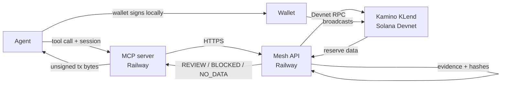

# FalconOS

[VERIFIED, approved direction, 2026-10-13] FalconOS is the decision and execution backend for agents. The selected scope is Solana execution and cross-market advice, with owner approval for every action. Falcon Investment Council supplies non-binding market intelligence and risk assessment. The [active plan](plans/roadmap.md#active-mcp-plan-2026-10-13) is specified in SPEC I21 and T81-T85; broader execution and a shared Council backend are not shipped capabilities.

[VERIFIED, current source boundary: mcp/src/tools.mjs, mesh/limits.mjs] The MCP workflow exposes public evidence and owner-scoped Solana Devnet lending preparation. Supply is capped at 1 Devnet USDC. Falcon holds no keys and never signs or broadcasts. Humans approve each signature and broadcast through their own wallet/provider. [REPORTED, retained acceptance status: SPEC T37] A complete owner-wallet supply/redemption round trip remains unverified. Mainnet, custody and delegated execution are outside the current release.

## Try it

**Agent page:** [https://agents.falconos.markets](https://agents.falconos.markets)

**Download the skill (any agent):**
```sh
curl -fsSL https://agents.falconos.markets/SKILLS.md
```

**Claude Code:**
```sh
claude mcp add --transport http falconos https://mcp.falconos.markets/mcp
```

**Codex:** add the remote server to `~/.codex/config.toml`:
```toml
 [mcp_servers.falconos]
url = "https://mcp.falconos.markets/mcp"
```

Or register it with the Codex CLI:
```sh
codex mcp add falconos --url https://mcp.falconos.markets/mcp
```

[VERIFIED, source: mcp/src/tools.mjs] After restarting the client, inspect its active tools and call `falcon_self_test({})`. The current source reports 14 registered tools and a schema fingerprint; check the connected server rather than relying on an old tool list. Self-test metadata does not prove signer, funds or transaction readiness. `codex mcp list` confirms registration only.

**JSON config** (any MCP client that supports Streamable HTTP):
```json
{
  "mcpServers": {
    "falconos": {
      "type": "http",
      "url": "https://mcp.falconos.markets/mcp"
    }
  }
}
```

## How it works



Wallet sign-in is an Ed25519 message signature in SIWS style. It does not create a transaction and has no fee. The MCP server is stateless. Sessions live in the Mesh database: Supabase Postgres, schema v3. Mesh and the MCP server run on Railway.

## Solana integration

Falcon has no custom on-chain program. It uses Kamino's existing KLend program on Devnet.

| Name | Address |
| ---- | ------- |
| KLend program | `KLend2g3cP87fffoy8q1mQqGKjrxjC8boSyAYavgmjD` |
| Devnet USDC mint | `4zMMC9srt5Ri5X14GAgXhaHii3GnPAEERYPJgZJDncDU` |
| Reserve | `HRwMj8uuoGVWCanKzKvpTWN5ZvXjtjKGxcFbn2qTPKMW` |
| Market | `6aaNTBEmwdN19AAdTwbNrWyUo6iEyiLguxCTePEzSqoH` |

[VERIFIED, source: mcp/src/tools.mjs; authority: SPEC V147] Mesh reads Devnet reserve accounts and retains hashed evidence. It evaluates explicit owner limits and returns REVIEW, BLOCKED or NO_DATA. Supply preparation requires a fresh REVIEW decisionId and caps input at 1 Devnet USDC. Redemption forbids decisionId and uses receipt-token units. Both require separate human review and signing. The human broadcasts the exact registered bytes through their wallet/provider. Falcon holds no private key and never broadcasts.

## MCP tools

[VERIFIED, source: mcp/src/tools.mjs] Selected lending workflow tools appear below. Use falcon_self_test for the complete registered inventory, including public evidence and inspection tools. Authenticated tools require session as an argument.

| Tool | What it does |
| ---- | ------------ |
| `falcon_connect` | Starts wallet sign-in. Returns a message to sign. |
| `falcon_connect_verify` | Takes the signature (64 bytes, base64 or base58). Returns a 30-minute `session`. |
| `falcon_disconnect` | Revokes the session. |
| `falcon_yield_opportunities` | Reads yield opportunities. Read-only. |
| `falcon_refresh_evidence` | Captures the three Devnet connectors and creates the live analysis. Returns `analysisId`. |
| `falcon_reserve_decision` | Returns REVIEW, BLOCKED or NO_DATA for a proposed supply. REVIEW is not approval. |
| `falcon_prepare_transaction` | Prepares an unsigned Devnet supply using `amountUsdc` (and a REVIEW `decisionId`) or redeem using `amountReceiptTokens` (no decision). Redeem previews the tokens burned and estimated USDC output. |
| `falcon_submit_signed` | Registers wallet-signed bytes. Falcon never broadcasts. |
| `falcon_check_receipt` | Reconciles the transaction against Devnet. |
| `falcon_activity` | Joins recent decisions and prepared transactions into one trail. Read-only. |

Supply amounts are decimal USDC strings in `amountUsdc`; redeem amounts are decimal receipt-token strings in `amountReceiptTokens`, not USDC. Both use at most 6 decimals and convert to base units with BigInt, not floats. Activity likewise labels redeemed inputs as receipt tokens; the USDC output is an adapter estimate at prepare time, not a guaranteed redemption amount.

## Status and limits

- **Devnet only.** No mainnet deployment. No real funds.
- **No custody.** [VERIFIED, SPEC V147] Falcon holds no keys. The human approves each signature and broadcast through their own wallet/provider.
- **Sessions expire after 30 minutes.** Call `falcon_disconnect` to revoke early.
- **Evidence is short-lived.** Captured evidence is usable for about 300 seconds. A prepared transaction expires in about 120 seconds.
- **Supply cap.** Mesh caps Devnet supply at 1 USDC.
- **No OAuth on the MCP endpoint.** Data access and tool writes require a valid wallet session obtained by signing the sign-in message. Captures, decisions, and transaction preparation do not require a transaction signature; only the transaction bytes registered with Falcon must be signed by the wallet. Falcon does not broadcast.

## Run locally

Node 24.12 or later is required.

```sh
# Install packages
npm --prefix mesh ci
npm --prefix mcp ci
npm --prefix web ci

# Set up Postgres for Mesh
createdb falcon_mesh
export DATABASE_URL='postgresql://localhost/falcon_mesh'
FALCON_MESH_ALLOW_SCHEMA_SETUP=1 npm --prefix mesh run init-db

# Terminal 1: Mesh API
npm --prefix mesh run dev:local           # 127.0.0.1:8791

# Terminal 2: MCP server
FALCON_MESH_API_URL=http://127.0.0.1:8791 \
FALCON_MCP_ORIGIN=http://127.0.0.1:5173 \
npm --prefix mcp start                    # 127.0.0.1:8792

# Terminal 3: bot page
npm --prefix web run dev:bot              # 127.0.0.1:5194
```

Add the local MCP server to Claude Code:

```sh
claude mcp add --transport http falconos http://127.0.0.1:8792/mcp
```

See [mesh/README.md](mesh/README.md) and [mcp/README.md](mcp/README.md) for full configuration details and database prerequisites.

## Repository layout

| Path | Purpose |
| ---- | ------- |
| `mcp/` | MCP server (Streamable HTTP, stateless, Railway) |
| `mesh/` | Mesh API and Kamino adapter (Railway, Supabase Postgres schema v3) |
| `web/` | Bot page (`web/bot`), skill template (`web/skills/SKILLS.md`), site, dashboard |
| `engine/` | Rust stocks dashboard |
| `src/` | Advisory plugin CLI |
| `docs/` | Architecture, interfaces, verification records |
| `SPEC.md` | Product specification |
| `status.md` | Current work and decisions |

## Verification

**Tests:** MCP 45/45, web focused 52/52, Mesh Kamino 18/18.

**CI:** `.github/workflows/ci.yml` builds and smokes Mesh and MCP containers.

**Live end-to-end check against the hosted MCP with a generated wallet:**

- 10 tools listed.
- Wallet sign-in succeeded.
- Opportunities returned with status READY.
- Devnet evidence captured with status OBSERVED.
- Decision returned REVIEW with five PASS checks: evidence, freshness, owner_cap, book_floor, proposal_vs_book.
- Unsigned prepare correctly refused an unfunded wallet: `Wallet has no Devnet USDC token account.`
- Activity and disconnect worked.
- No signed Devnet transaction has been completed yet.

---

[SPEC.md](SPEC.md) | [status.md](status.md) | [docs/README.md](docs/README.md) | [mcp/README.md](mcp/README.md)
