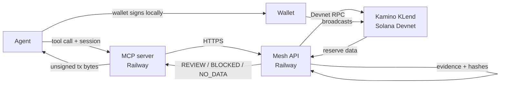

# FalconOS

[VERIFIED, approved direction, 2026-10-13] FalconOS is the decision and execution backend for agents. The selected scope is Solana execution and cross-market advice, with owner approval for every action. Falcon Investment Council supplies non-binding market intelligence and risk assessment. The [active plan](plans/roadmap.md#active-mcp-plan-2026-10-13) is specified in SPEC I21 and T81-T85; broader execution and a shared Council backend are not shipped capabilities.

[VERIFIED, legacy Solana boundary: mcp-rust/src/lib.rs, mesh/limits.mjs] The lending workflow exposes public evidence and owner-scoped Solana Devnet preparation. Supply is capped at 1 Devnet USDC. Falcon holds no keys and never signs. Humans approve and broadcast each legacy Solana transaction. The supply/redemption acceptance gate remains SPEC T82. The separate NEAR CFO source candidate below does not widen these limits.

## NEAR hackathon AI CFO

[VERIFIED USER APPROVAL, 2026-10-26] The owner approved an owner-controlled treasury workflow: reserve limits, allocation review, NEAR Intents execution, confirmed-proceeds rotation and reinvestment. The [CFO contract](docs/interfaces.md#owner-approved-near-ai-cfo-r1-2026-10-26) and SPEC I22/V197-V205 define the scope. This is company-owned treasury software, not a pooled investment fund or a grant of signing authority.

[VERIFIED LOCAL SOURCE; LIVE ACCEPTANCE BLOCKED] `mesh/cfo/` owns holdings, policy, immutable records and the action lifecycle. The private dashboard and ten Rust MCP tools call that backend. Owner signatures cover exact raw Ed25519 Intents payloads. A separate operator trial binds the action, quote, assets, amount, expiry and T82 proof. Unknown sends remain reserved; dependent investments wait for finalized matching receipts and a new approval.

[VERIFIED LOCAL MCP SMOKE] The actual Rust server and official client returned `MCP_HTTP_SMOKE_PASS`, `serverVersion:"0.6.0"`, `tools:29`, and `meshUnavailable:true`. This proves discovery and the backend-outage path, not live balances, review or settlement.

[OWNER GATES] Provider terms, partner and sender-discovery keys, model-call budget, T82 evidence and an exact capped mainnet trial remain separate. [VERIFIED OFFICIAL DOCS](https://docs.near-intents.org/resources/faqs.md): NEAR Intents has no testnet. Do not describe dry quotes, local fixtures or provider SUCCESS as funded execution proof. Stablecoin-denominated receipt positions can lose principal.

[VERIFIED PROVIDER TERMS; DESIGN GATE] [1Click Terms §4.1(e)](https://docs.near-intents.org/security-compliance/terms-of-service.md) limit API-data retention to 24 hours, except static transaction records needed for end-user history. Current R1 stores unexecuted quote snapshots without a retention limit. Live provider access requires a written exception or a separately approved retention design. These terms also restrict model training; permission for the planned inference use remains a provider-review question.

### Local review

1. Install the locked root, `mesh/`, `web/` and `mesh/council/runtime/` dependencies. Use Node 24.12 or later and pinned Bun 1.3.14 for the Council worker. Use an initialized disposable database with the reviewed schema 3 history; never point schema setup at production without approval.
2. Set `DATABASE_URL` to that reviewed local database. Run `npm --prefix mesh run dev:local`. It generates a local operator credential, but CFO routes still require a server-verified wallet session.
3. In another terminal, run `npm --prefix web run dev` and open `/dashboard/` on the displayed local URL. [EXPECTED] Wallet sign-in opens private retained state. It does not capture balances, start a model or sign a financial action.
4. [EXPECTED] With the provider disabled, an explicit portfolio capture records `NO_DATA`. Missing balances are not zero. All money limits remain owner-entered. Configure provider access only after terms and account approval.
5. After each separately authorized setup and trial gate passes, use the same dashboard to plan, review, sign, relay and reconcile. Rotate through confirmed reserve proceeds; reinvest only settled funds above the reserve floor. A pending or unverified result stops the next movement.

[VERIFIED LOCAL CONFIGURATION] Use development mode for a loopback HTTP API. A production build rejects HTTP, including loopback. Hosted builds need `VITE_MESH_API_URL=https://<approved-mesh-host>` at build time and the exact site origin in server `FALCON_MESH_ORIGINS`. Setting an environment variable after building does not rewrite the bundle.

### Provider and trial configuration

[SOURCE CONTRACT] `FALCON_CFO_PROVIDER_ENABLED=1` enables provider requests. `FALCON_CFO_PARTNER_API_KEY` and `FALCON_CFO_NEARBLOCKS_API_KEY` are server-only credentials. `FALCON_CFO_REVIEW_OWNERS`, `FALCON_CFO_EXECUTION_GRANTS` and `FALCON_CFO_EXECUTION_TRIALS` are bounded JSON arrays and default empty. Configuration is not operational readiness or owner consent. Keep credentials outside source and browser bundles.

[SOURCE CONTRACT] Sender discovery uses only the fixed NearBlocks transaction lookup. NEAR RPC must independently verify the exact signed intent and finalized token effects. T82's Explorer evidence remains an operator-retained observation bound to actual confirmed lending records; a proof UUID alone does not pass. No public endpoint can create a T82 proof or trial grant.

[VERIFIED EVENT BRIEF](https://nearhackathon.com/HACKATHON.md): NEAR HACKATHON runs November 1 through November 14, 2026, ending at 23:59 UTC. A public repository and public X demo are required. Prior-code judging treatment remains unresolved. No public post, repository publication or submission is authorized by the implementation approval.

## Human dashboard and agent interfaces

[VERIFIED LOCAL, D4] `/dashboard/` is the only human application workspace. It uses server-verified wallet sign-in and retained backend activity. Login does not authorize model work, signing or spending. Signup and organization workspaces remain unavailable. No sample portfolio or PnL is loaded. See the [owner dashboard contract](docs/interfaces.md#owner-dashboard-d4-contract-2026-10-23).

[VERIFIED SOURCE] Retired app, mesh, treasury and NEAR research workspace URLs redirect to the dashboard. Structured MCP/HTTP research, evidence and execution interfaces remain available under their existing authorization rules. Marketing and agent installation remain separate. Local system/simulator builds are not human deployment artifacts. Hosted routing and environment readiness remain unverified.

[VERIFIED LOCAL] The final web suite reported `tests321, pass321, fail0`. The production-built owner browser reported `passed14, total14`, including forged/revoked/expired sessions, retained data rendering and failed logout. These results do not prove hosted deployment. Current model and container limits are in [status](status.md).

## Try it

**Agent install route in current source:** [https://agents.falconos.markets/install/](https://agents.falconos.markets/install/). Hosted cutover is not verified.

**Download the skill (any agent):**
```sh
curl -fsSL https://agents.falconos.markets/SKILLS.md
```

**Claude Code:**
```sh
claude mcp add --transport http falconos https://mcp.falconos.markets/mcp
```

**Codex:** add the remote server to `~/.codex/config.toml`:
```toml
 [mcp_servers.falconos]
url = "https://mcp.falconos.markets/mcp"
```

Or register it with the Codex CLI:
```sh
codex mcp add falconos --url https://mcp.falconos.markets/mcp
```

[VERIFIED LOCAL SOURCE 0.6.0; hosted cutover unverified] Restart the client, list tools and call `falcon_self_test({})`. Current source exposes 29 tools with per-domain scope. Metadata does not verify the wallet session, signer, funds, operator review grant, exact trial permission or native model host. `codex mcp list` confirms registration only. The [Rust guide](mcp-rust/README.md) separates CFO and legacy lending. The dated [hosted 0.4.0 record](status.md#rust-mcp-cutover-2026-10-15) remains historical.

**JSON config** (any MCP client that supports Streamable HTTP):
```json
{
  "mcpServers": {
    "falconos": {
      "type": "http",
      "url": "https://mcp.falconos.markets/mcp"
    }
  }
}
```

## How it works



Wallet sign-in is an Ed25519 message signature in SIWS style. It does not create a transaction and has no fee. The MCP server is stateless. Sessions live in the Mesh database: Supabase Postgres, schema v3. Mesh and the MCP server run on Railway.

## Solana integration

Falcon has no custom on-chain program. It uses Kamino's existing KLend program on Devnet.

| Name | Address |
| ---- | ------- |
| KLend program | `KLend2g3cP87fffoy8q1mQqGKjrxjC8boSyAYavgmjD` |
| Devnet USDC mint | `4zMMC9srt5Ri5X14GAgXhaHii3GnPAEERYPJgZJDncDU` |
| Reserve | `HRwMj8uuoGVWCanKzKvpTWN5ZvXjtjKGxcFbn2qTPKMW` |
| Market | `6aaNTBEmwdN19AAdTwbNrWyUo6iEyiLguxCTePEzSqoH` |

[VERIFIED, source: mcp-rust/src/lib.rs, mesh/lending-store.mjs; authority: SPEC V147] Mesh evaluates explicit owner limits and returns REVIEW, BLOCKED or NO_DATA. Supply preparation requires a fresh REVIEW decisionId and caps input at 1 Devnet USDC. Redemption forbids decisionId and uses receipt-token units. Both require separate human review and signing. The human broadcasts the exact registered bytes. Falcon holds no private key and never broadcasts.

## MCP tools

[VERIFIED, source: mcp-rust/src/lib.rs] Selected lending tools appear below. Use `falcon_self_test` for the complete inventory, including public evidence and inspection. Authenticated tools require a session argument.

| Tool | What it does |
| ---- | ------------ |
| `falcon_connect` | Starts wallet sign-in. Returns a message to sign. |
| `falcon_connect_verify` | Takes the signature (64 bytes, base64 or base58). Returns a 30-minute `session`. |
| `falcon_disconnect` | Revokes the session. |
| `falcon_yield_opportunities` | Reads yield opportunities. Read-only. |
| `falcon_refresh_evidence` | Captures the three Devnet connectors and creates the live analysis. Returns `analysisId`. |
| `falcon_reserve_decision` | Returns REVIEW, BLOCKED or NO_DATA for a proposed supply. REVIEW is not approval. |
| `falcon_prepare_transaction` | Prepares an unsigned Devnet supply using `amountUsdc` (and a REVIEW `decisionId`) or redeem using `amountReceiptTokens` (no decision). Redeem previews the tokens burned and estimated USDC output. |
| `falcon_submit_signed` | Registers wallet-signed bytes. Falcon never broadcasts. |
| `falcon_check_receipt` | Reconciles the transaction against Devnet. |
| `falcon_activity` | Joins recent decisions and prepared transactions into one trail. Read-only. |

Supply amounts are decimal USDC strings in `amountUsdc`; redeem amounts are decimal receipt-token strings in `amountReceiptTokens`, not USDC. Both use at most 6 decimals and convert to base units with BigInt, not floats. Activity likewise labels redeemed inputs as receipt tokens; the USDC output is an adapter estimate at prepare time, not a guaranteed redemption amount.

## Status and limits

- **Devnet only.** No mainnet deployment. No real funds.
- **No custody.** [VERIFIED, SPEC V147] Falcon holds no keys. The human approves each signature and broadcast through their own wallet/provider.
- **Sessions expire after 30 minutes.** Call `falcon_disconnect` to revoke early.
- **Evidence is short-lived.** Captured evidence is usable for about 300 seconds. A prepared transaction expires in about 120 seconds.
- **Supply cap.** Mesh caps Devnet supply at 1 USDC.
- **No OAuth on the MCP endpoint.** Data access and tool writes require a valid wallet session obtained by signing the sign-in message. Captures, decisions, and transaction preparation do not require a transaction signature; only the transaction bytes registered with Falcon must be signed by the wallet. Falcon does not broadcast.

## Run locally

Rust builds MCP. Node 24.12 or later remains required for Mesh and the web app.

```sh
# Install packages
npm --prefix mesh ci
npm --prefix web ci

# Set up Postgres for Mesh
createdb falcon_mesh
export DATABASE_URL='postgresql://localhost/falcon_mesh'
FALCON_MESH_ALLOW_SCHEMA_SETUP=1 npm --prefix mesh run init-db

# Terminal 1: Mesh API
npm --prefix mesh run dev:local           # 127.0.0.1:8791

# Terminal 2: MCP server
FALCON_MESH_API_URL=http://127.0.0.1:8791 \
FALCON_MCP_ORIGIN=http://127.0.0.1:5173 \
sh scripts/run-mcp-rust.sh                # 127.0.0.1:8792

# Terminal 3: bot page
npm --prefix web run dev:bot              # 127.0.0.1:5194
```

Add the local MCP server to Claude Code:

```sh
claude mcp add --transport http falconos http://127.0.0.1:8792/mcp
```

See [mesh/README.md](mesh/README.md) and [mcp-rust/README.md](mcp-rust/README.md) for configuration and database prerequisites.

## Repository layout

| Path | Purpose |
| ---- | ------- |
| `mcp-rust/` | Rust MCP server (Streamable HTTP, stateless, Railway) |
| `mesh/` | Mesh API and Kamino adapter (Railway, Supabase Postgres schema v3) |
| `web/` | Owner dashboard, marketing, agent install/skill files, separate local system and simulator sources |
| `engine/` | Rust stocks dashboard |
| `src/` | Advisory plugin CLI |
| `docs/` | Architecture, interfaces, verification records |
| `SPEC.md` | Product specification |
| `status.md` | Current work and decisions |

## Verification

Run `npm run verify:mcp` for the maintained Rust MCP checks. CI builds and smokes the Mesh and Rust MCP containers [VERIFIED, verification entrypoints].

The [Rust cutover record](status.md#rust-mcp-cutover-2026-10-15) retains exact deployment and test evidence. Hosted reads proved 14 tools and an OBSERVED public graph. Local real-Mesh/PostgreSQL integration prepared unsigned supply and redeem transactions using external RPC fixtures [VERIFIED, retained smoke evidence].

No owner-funded Devnet transaction round trip has been completed by these checks. T82 still requires separately approved signing, broadcast, confirmed receipts and Explorer proof. Historical Node results remain in the [pre-retirement README](https://github.com/Sarthib7/FalconOS/blob/7ff245cb7849deea327474a65f14d2b7e398c1a8/README.md#verification).

---

[SPEC.md](SPEC.md) | [status.md](status.md) | [docs/README.md](docs/README.md) | [mcp-rust/README.md](mcp-rust/README.md)
